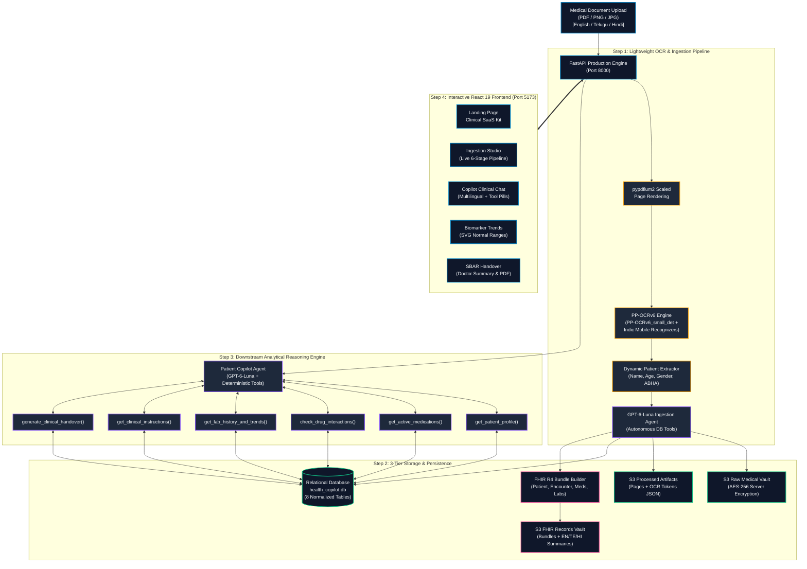

# AI-Powered Personal Health Copilot

[](https://abdm.gov.in/)
[](https://hl7.org/fhir/R4/)
[](https://openai.com/)
[](https://github.com/PaddlePaddle/PaddleOCR)
[](https://react.dev/)
[](https://fastapi.tiangolo.com/)
[](https://aws.amazon.com/)

An enterprise-grade, end-to-end clinical AI system built for India's digital health ecosystem (**Ayushman Bharat Digital Mission - ABDM**). The **AI-Powered Personal Health Copilot** transforms raw, noisy, handwritten and printed medical documents (outpatient prescriptions, 16-page diagnostic lab reports, discharge summaries) code-mixed in **English, Telugu (తెలుగు), and Hindi (हिन्दी)** into normalized relational health databases, standardized **HL7 FHIR R4** bundles, and interactive patient-clinician analytical applications.

---

## Table of Contents

- [1. Executive Summary](#1-executive-summary)
- [2. System Architecture](#2-system-architecture)
- [3. Key Features](#3-key-features)
- [4. Technology Stack](#4-technology-stack)
- [5. Project Directory Structure](#5-project-directory-structure)
- [6. Prerequisites](#6-prerequisites)
- [7. Configuration & Environment Variables](#7-configuration--environment-variables)
- [8. Installation & Setup](#8-installation--setup)
  - [Backend Setup](#backend-setup)
  - [Frontend Setup](#frontend-setup)
- [9. Running the Application](#9-running-the-application)
  - [Development Mode](#development-mode)
  - [Production Mode (EC2 / Linux Server)](#production-mode-ec2--linux-server)
- [10. API Reference](#10-api-reference)
- [11. Relational Database Schema](#11-relational-database-schema)
- [12. S3 3-Tier Vault Storage Pipeline](#12-s3-3-tier-vault-storage-pipeline)
- [13. Testing & Benchmarking](#13-testing--benchmarking)
- [14. Clinical Safety & Guardrails](#14-clinical-safety--guardrails)
- [15. License & Medical Disclaimer](#15-license--medical-disclaimer)

---

## 1. Executive Summary

India's healthcare delivery is characterized by handwritten outpatient prescriptions, code-mixed bilingual dosage directions (e.g., Telugu directions like *"భోజనం తర్వాత రెండు పూటలా"* or Hindi directions like *"दिन में दो बार खाने के बाद"*), multi-page complex diagnostic panels (such as 16-page Thyrocare full-body lab checkups), and fragmented patient records across non-interoperable clinics.

The **AI-Powered Personal Health Copilot** unifies computer vision, autonomous LLM agents, and clinical decision support into a secure, low-latency pipeline:
1. **Lightweight Indic OCR Pipeline**: Couples `PP-OCRv6_small_det` with localized recognition models (`te_PP-OCRv5_mobile_rec`, `devanagari_PP-OCRv5_mobile_rec`, and `PP-OCRv6_small_rec`) for low-latency, CPU-friendly text extraction without GPU requirements.
2. **Dynamic Demographic Extraction**: Automatically extracts patient name, age, gender, and clinical identifiers from raw document tokens, eliminating hardcoded patient mappings.
3. **Autonomous Ingestion Agent (`gpt-6-luna`)**: Inspects database schemas, runs identity resolution queries, and commits clean medical entities into 7 relational tables.
4. **3-Tier Encrypted S3 Vault**: Encrypts raw uploads (AES-256), archives OCR token geometries, and stores ABDM-compliant FHIR R4 JSON bundles with multilingual patient summaries.
5. **Downstream Clinical Copilot (`gpt-6-luna`)**: An analytical clinical reasoning engine backed by 6 deterministic query tools, cross-encounter drug interaction checkers, longitudinal lab trending, and emergency triage protocols.
6. **Modern Clinical Dashboard**: A React 19 + TypeScript SPA featuring Ingestion Studio, Copilot Chat with interactive tool pills, SVG Biomarker Trend Charts, and SBAR Doctor Handover notes.

---

## 2. System Architecture



---

## 3. Key Features

### 📄 Multilingual Indic Document Ingestion
- Ingests scanned or digital prescriptions, lab diagnostic sheets, and discharge summaries.
- Supports code-mixed textlines in **Telugu (తెలుగు)**, **Hindi (हिन्दी)**, and **English**.
- Powered by PaddleOCR v6 paired with lightweight mobile recognition heads (`te_PP-OCRv5_mobile_rec`, `devanagari_PP-OCRv5_mobile_rec`, `PP-OCRv6_small_rec`) to eliminate out-of-memory errors on standard cloud instances.

### 👤 Dynamic Patient Identity Resolution
- Scans OCR tokens for patient identity banners (`Name: Vineetha (21Y/F)`, `రోగి: రమేష్ రావు`, `मरीज़: सुनीता शर्मा`).
- Dynamically creates patient master records with synthetic or detected ABHA IDs if new, or attaches records to existing profiles to eliminate patient collision.

### 🤖 GPT-6-Luna Ingestion Agent
- Uses function calling over general tools (`get_ocr_input`, `get_db_schema`, `run_sql_query`, `insert_into_table`).
- Normalizes drug names, strengths, frequency codes (`1-0-1`, `OD`, `TDS`), and meal timings (`before meals`, `after meals`).
- Preserves original Indic instructions alongside standardized English translations.
- Maps lab tests to standard biological reference ranges, units, and LOINC codes.

### 🔒 3-Tier S3 Vault Architecture
- **Raw Vault**: Tamper-proof, versioned, server-side encrypted (AES-256) original file repository.
- **Processed Artifacts Vault**: High-resolution page renders and structured OCR token geometry files (`ppocrv6_tokens.json`).
- **FHIR Records Vault**: Standard FHIR R4 document bundles and auto-generated multilingual patient explanations in English, Telugu, and Hindi.

### 💬 Conversational Copilot with Deterministic Grounding
- Downstream patient and physician assistant powered by `gpt-6-luna`.
- Pre-loaded verified clinical context to deliver sub-2-second response times without redundant tool calls.
- Deterministic clinical tools prevent hallucinations for drug interactions, longitudinal trends, and clinical instructions.
- Strict medical safety guardrails: non-prescriptive tone, emergency red-flag triage for hypoglycemia and hypertensive crises.

### 📊 Biomarker Trends & Doctor Handover
- Interactive SVG charts for critical longitudinal markers: **HbA1c**, **Fasting Blood Sugar (FBS)**, **Serum Creatinine**, and **Blood Pressure**.
- Shaded biological normal reference bands with automated clinical drift warnings.
- One-click SBAR (Situation, Background, Assessment, Recommendation) structured note generation for physician handovers.

---

## 4. Technology Stack

| Domain | Technology / Library | Version / Details |
| :--- | :--- | :--- |
| **Frontend Framework** | React + TypeScript + Vite | React 19, TypeScript 5.8, Vite 6 |
| **Styling & UI** | Tailwind CSS + Lucide Icons | Tailwind CSS 3.4, Lucide React, Custom Dark Clinical Palette |
| **Backend Framework** | FastAPI + Uvicorn | FastAPI 0.100+, Starlette, ASGI Async Non-Blocking Architecture |
| **LLM & Reasoning** | OpenAI Python SDK | `gpt-6-luna` with tool execution (`reasoning_effort="none"`) |
| **OCR & Vision** | PaddlePaddle + PaddleOCR + pypdfium2 | PP-OCRv6, PP-OCRv5 Indic Mobile, pypdfium2 1.5x scaled renderer |
| **Database** | SQLite3 (MySQL compatible schema) | WAL mode, foreign key enforcement, 8 relational tables & indexes |
| **Cloud Storage** | AWS S3 via Boto3 | 3-tier partitioned vaults, AES-256 SSE, versioning enabled |
| **Cloud Compute** | AWS EC2 (Ubuntu 22.04 LTS) | Dual-server architecture (FastAPI port 8000, Vite/Proxy port 5173) |

---

## 5. Project Directory Structure

```text
Health_Copilot/
├── frontend/                              # React 19 TypeScript Frontend Application
│   ├── src/
│   │   ├── assets/                        # Static brand assets and icons
│   │   ├── components/                    # Core clinical UI components
│   │   │   ├── ui/
│   │   │   │   └── saa-s-template.tsx     # Customized Dark Clinical Landing Page
│   │   │   ├── BiomarkerTrends.tsx        # Interactive SVG Longitudinal Lab Charts
│   │   │   ├── CopilotChat.tsx            # Multilingual GPT-6-Luna Clinical Chat
│   │   │   ├── IngestionStudio.tsx        # Multi-stage Drag-and-Drop Ingestion UI
│   │   │   ├── Navbar.tsx                 # Dynamic Patient Context & Module Switcher
│   │   │   └── SbarHandover.tsx           # SBAR Physician Clinical Handover View
│   │   ├── lib/
│   │   │   ├── api.ts                     # REST client for FastAPI (ports 8000/5173)
│   │   │   └── utils.ts                   # Tailwind merge and class utility helpers
│   │   ├── types.ts                       # Shared TypeScript clinical schemas
│   │   ├── App.tsx                        # Root view router with hash navigation
│   │   └── main.tsx                       # React DOM entrypoint
│   ├── package.json                       # Frontend dependencies & scripts
│   ├── tailwind.config.js                 # Clinical cyan, teal, and slate theme tokens
│   ├── tsconfig.json                      # TypeScript compiler configuration
│   └── vite.config.ts                     # Vite build and proxy configuration
├── server.py                              # FastAPI Production Backend Server
├── copilot_analytical_engine.py           # Downstream GPT-6-Luna Patient Copilot & Tools
├── luna_ingestion_agent.py                # Autonomous GPT-6-Luna Clinical Ingestion Agent
├── health_db.py                           # SQLite Relational Database Engine & Schema
├── s3_storage_manager.py                  # AWS S3 3-Tier Vault Storage Pipeline
├── frontend_server.py                     # Multi-threaded Production SPA & Reverse Proxy
├── benchmark_system_performance.py        # System-wide Latency and Throughput Benchmark
├── test_e2e_live_flow.py                  # End-to-End Ingestion & Query Test Suite
├── test_copilot_engine.py                 # Clinical Safety & Copilot Tool Unit Tests
├── run_indic_sanity_test.py               # Multilingual Indic OCR Verification Script
├── setup_ppocr_v6.sh                      # Shell automation for PP-OCRv6 environment
├── .env                                   # Environment configuration (git-ignored)
└── README.md                              # Project documentation
```

---

## 6. Prerequisites

Ensure your development or server environment meets these requirements:

- **Python**: Version 3.10 or higher.
- **Node.js**: Version 20.x or higher (npm 10+).
- **System Libraries (Linux)**: OpenCV and rendering dependencies (`libgl1-mesa-glx`, `libglib2.0-0`, `libgomp1`).
- **OpenAI API Access**: API key with access to `gpt-6-luna`.
- **AWS Credentials**: IAM user or role with permissions for S3 (`s3:PutObject`, `s3:GetObject`, `s3:ListBucket`) and EC2.

---

## 7. Configuration & Environment Variables

Create a `.env` file in the project root directory. Use the template below:

```ini
# ==============================================================================
# AWS Cloud Configuration (S3 Vaults & Compute)
# ==============================================================================
AWS_ACCESS_KEY_ID=your_aws_access_key_id_here
AWS_SECRET_ACCESS_KEY=your_aws_secret_access_key_here
AWS_DEFAULT_REGION=your_aws_region_here

# ==============================================================================
# OpenAI LLM Engine Configuration
# ==============================================================================
OPENAI_API_KEY=your_openai_api_key_here
OPENAI_MODEL=gpt-6-luna

# ==============================================================================
# Optional Runtime Flags (PaddlePaddle CPU Execution)
# ==============================================================================
PADDLE_PDX_ENABLE_MKLDNN_BYDEFAULT=0
FLAGS_use_mkldnn=0
PADDLE_PDX_DISABLE_MODEL_SOURCE_CHECK=True
```

> **Security Note:** Never commit `.env` or files containing private credentials to source control. Ensure `.env` is listed in `.gitignore`.

---

## 8. Installation & Setup

### Backend Setup

1. **Clone the repository:**
   ```bash
   git clone https://github.com/Vineetha-56/Health_Copilot.git
   cd Health_Copilot
   ```

2. **Install system-level libraries (Ubuntu/Debian):**
   ```bash
   sudo apt-get update -y
   sudo apt-get install -y libgl1-mesa-glx libglib2.0-0 libgomp1 libspatialindex-dev
   ```

3. **Create and activate a Python virtual environment:**
   ```bash
   # On Linux/macOS
   python3 -m venv venv
   source venv/bin/activate

   # On Windows (PowerShell)
   python -m venv venv
   .\venv\Scripts\Activate.ps1
   ```

4. **Install backend dependencies:**
   ```bash
   pip install --upgrade pip setuptools wheel
   pip install fastapi uvicorn[standard] pydantic boto3 python-multipart pypdfium2 pillow openai
   pip install paddlepaddle -i https://www.paddlepaddle.org.cn/packages/stable/cpu/
   pip install "paddleocr[all]"
   ```

5. **Initialize the relational clinical database:**
   ```bash
   python -c "import health_db; health_db.init_db()"
   ```
   This creates `health_copilot.db` with all 8 tables and performance indexes.

---

### Frontend Setup

1. **Navigate to the frontend directory:**
   ```bash
   cd frontend
   ```

2. **Install Node packages:**
   ```bash
   npm install
   ```

3. **Build the production bundle:**
   ```bash
   npm run build
   ```
   The compiled assets will be placed in `frontend/dist/`.

---

## 9. Running the Application

### Development Mode

#### Step 1: Start the FastAPI Backend
From the project root directory:
```bash
uvicorn server:app --host 0.0.0.0 --port 8000 --reload
```
The API documentation is accessible at `http://localhost:8000/docs`.

#### Step 2: Start the Vite Development Frontend
In a separate terminal, from `frontend/`:
```bash
npm run dev -- --host 0.0.0.0 --port 5173
```
Open your browser at `http://localhost:5173`.

---

### Production Mode (EC2 / Linux Server)

For production deployments on AWS EC2 or Linux virtual machines:

1. **Build the frontend production bundle:**
   ```bash
   cd frontend && npm run build && cd ..
   cp -r frontend/dist /home/ubuntu/frontend_dist
   ```

2. **Launch both services in the background using `nohup` or `systemd`:**
   ```bash
   # Start FastAPI Backend on Port 8000
   nohup python3 server.py > server.log 2>&1 &

   # Start Multi-Threaded Frontend Server on Port 5173
   nohup python3 frontend_server.py > frontend.log 2>&1 &
   ```

3. **Verify running processes:**
   ```bash
   ps -ef | grep python3
   curl -I http://localhost:8000/api/patients
   curl -I http://localhost:5173/
   ```

---

## 10. API Reference

All backend endpoints are hosted on port `8000` (and reverse-proxied through port `5173/api/`).

### Ingestion & Processing

#### `POST /api/process-record`
Processes an uploaded medical document, performs multilingual OCR, dynamically extracts patient identity, runs the `gpt-6-luna` Ingestion Agent, writes to SQLite, builds a FHIR R4 bundle, and stores artifacts in S3.

- **Content-Type**: `multipart/form-data`
- **Parameters**:
  - `file`: Document file (`.pdf`, `.png`, `.jpg`, `.jpeg`).
  - `language`: `auto`, `te` (Telugu), `hi` (Hindi), or `en` (English).
  - `encounter_type`: `prescription`, `lab_report`, or `discharge_summary`.
  - `abha_id`: Optional (defaults to `auto` for automated demographic extraction).

**Example Response**:
```json
{
  "status": "success",
  "record_id": "rec_1791980756982",
  "encounter_id": "ENC-rec_1791980756982",
  "patient_id": "PAT-VINEETHA-21F",
  "patient": {
    "patient_id": "PAT-VINEETHA-21F",
    "full_name": "Vineetha",
    "age": 21,
    "gender": "Female"
  },
  "ocr_latency_ms": 1840.2,
  "ingestion": {
    "status": "success",
    "model": "gpt-6-luna",
    "medications_count": 0,
    "labs_count": 42,
    "diagnoses_count": 1
  },
  "s3_storage": {
    "raw_key": "users/91-8842-1920-2026/records/rec_1791980756982/original_report.pdf",
    "fhir_key": "fhir/PAT-VINEETHA-21F/ENC-rec_1791980756982_fhir.json"
  }
}
```

---

### Conversational Copilot

#### `POST /api/copilot/chat`
Submits a clinical query to the downstream `gpt-6-luna` analytical engine.

- **Request Body**:
  ```json
  {
    "patient_id": "PAT-VINEETHA-21F",
    "message": "Can you summarize my recent Thyrocare test results?",
    "language": "auto"
  }
  ```
- **Response**:
  ```json
  {
    "status": "success",
    "model": "gpt-6-luna",
    "patient_id": "PAT-VINEETHA-21F",
    "answer": "Hello Vineetha. Your recent Thyrocare health checkup shows 42 lab observations across hemogram, lipid profile, and thyroid panels...",
    "invoked_tools": ["get_lab_history_and_trends"],
    "latency_ms": 1420.5
  }
  ```

---

### Longitudinal Queries

| Endpoint | Method | Description |
| :--- | :--- | :--- |
| `/api/patients` | `GET` | Returns list of all registered patients, encounter counts, and conditions. |
| `/api/patient/{id}/timeline` | `GET` | Retrieves full longitudinal history: demographics, encounters, medications, labs, vitals. |
| `/api/patient/{id}/labs/{test}`| `GET` | Returns historical time-series data points for a specific biomarker (e.g. `HbA1c`). |
| `/api/db/stats` | `GET`, `HEAD` | Returns SQLite table row counts and health status. |

---

## 11. Relational Database Schema

The database `health_copilot.db` is built with foreign-key referential integrity and SQLite WAL mode enabled:

```
+---------------------------------------------------------------------------------+
|                                    PATIENTS                                     |
| patient_id (PK) | abha_id (UQ) | full_name | age | gender | phone | created_at  |
+---------------------------------------------------------------------------------+
                                       │  1:N
                                       ▼
+---------------------------------------------------------------------------------+
|                                   ENCOUNTERS                                    |
| encounter_id (PK) | patient_id (FK) | date | type | doctor | s3_keys | ...      |
+---------------------------------------------------------------------------------+
          │                         │                         │
          ├─────────────────────────┼─────────────────────────┤
          ▼ 1:N                     ▼ 1:N                     ▼ 1:N
+-------------------+     +-------------------+     +-------------------+
|    MEDICATIONS    |     | LAB_OBSERVATIONS  |     |     DIAGNOSES     |
| drug_name, dosage |     | test_name, value  |     | condition_name    |
| Indic instructions|     | ref_range, LOINC  |     | icd10, status     |
+-------------------+     +-------------------+     +-------------------+
          │                         │
          ▼ 1:N                     ▼ 1:N
+-------------------+     +-------------------------+
|      VITALS       |     |  CLINICAL_INSTRUCTIONS  |
| BP, pulse, temp   |     | category, Telugu/Hindi  |
+-------------------+     +-------------------------+
```

---

## 12. S3 3-Tier Vault Storage Pipeline

Medical data is partitioned into 3 isolated AWS S3 buckets to guarantee patient confidentiality and compliance:

```text
# 1. Raw Ingestion Vault (Encrypted original PDFs/images)
s3://health-copilot-raw-records-{ACCOUNT_ID}/
  └── users/{abha_id}/records/{record_id}/original_{filename}

# 2. Processed Artifacts Vault (Rendered pages and OCR token JSON)
s3://health-copilot-processed-artifacts-{ACCOUNT_ID}/
  └── users/{abha_id}/records/{record_id}/
        ├── pages/page_1.png
        └── ocr/ppocrv6_tokens.json

# 3. ABDM / FHIR Data Store (FHIR R4 Bundles and Multilingual Summaries)
s3://health-copilot-fhir-records-{ACCOUNT_ID}/
  └── patients/{patient_id}/
        ├── fhir/bundle_{encounter_id}.json
        └── summaries/
              ├── summary_en_{encounter_id}.json   (English)
              ├── summary_te_{encounter_id}.json   (Telugu)
              └── summary_hi_{encounter_id}.json   (Hindi)
```

---

## 13. Testing & Benchmarking

The codebase includes end-to-end testing and performance verification suites:

### 1. Run Live End-to-End Pipeline Test
Tests upload, OCR execution, agent reasoning, database writes, and timeline querying:
```bash
python test_e2e_live_flow.py
```

### 2. Run Copilot Clinical Engine Unit Tests
Tests clinical tools, drug-drug interaction detection, and safety guardrails:
```bash
python test_copilot_engine.py
```

### 3. Run System-Wide Performance Benchmark
Benchmarks OCR processing speeds across model sizes, agent step counts, and chat latency:
```bash
python benchmark_system_performance.py
```

### 4. Run Multilingual Indic OCR Sanity Suite
Verifies bounding box detection and Telugu/Hindi character recognition:
```bash
python run_indic_sanity_test.py
```

---

## 14. Clinical Safety & Guardrails

The analytical engine is bounded by strict clinical safety protocols:

1. **Zero Hallucination Grounding**: Responses are derived strictly from deterministic database tool queries. Every clinical statement cites doctor, clinic/hospital, and encounter date.
2. **Non-Prescriptive Role**: The Copilot explains and clarifies existing prescriptions. It strictly refuses to change dosages, prescribe new pharmaceuticals, or discontinue treatments.
3. **Emergency Red-Flag Triage**:
   - **Hypoglycemia Alert**: Symptoms such as tremors, cold sweats, dizziness, or palpitations on secretagogues (e.g. Glimepiride) immediately trigger the "Rule of 15" protocol (consume 15g fast sugar, rest 15 mins, re-check).
   - **Hypertensive Crisis Alert**: Severe headaches, chest discomfort, or visual disturbances trigger immediate emergency department referrals.

---

## 15. License & Medical Disclaimer

### Medical Disclaimer
This software is developed for research, workflow automation, and clinical demonstration purposes under the ABDM framework. It is **not** a substitute for professional medical diagnosis, treatment, or advice. Always consult a licensed medical practitioner for health-related concerns.

### License
This project is licensed under the Apache License 2.0. See the `LICENSE` file for details.
# 🚀 AI-Powered Personal Health Copilot

### Intelligent Healthcare Document Processing, Patient Record Management & AI-Powered Clinical Decision Support

🌐 **Live Application:** http://3.27.249.44:5173

---


